# Pipeline CI на Rust #1 в GitHub Actions

Цель работы — проверить небольшое приложение на Rust edition 2021, собрать его в режимах debug и release и сохранить запускаемый Docker-образ как артефакт GitHub Actions. Программа выводит `Hello from Rust in Docker! 🦀`. [Методичка преподавателя](https://github.com/rurewa/imfua/blob/main/content/DevOps/CI_CD/Pipelines/Rust_CI_1.md)

Локальные проверки и первый запуск GitHub Actions прошли. Docker-образ из артефакта восстановлен и проверен локально. [Первый запуск](https://github.com/aleks-maker-maker/my-rust-app/actions/runs/44559837351)

## Структура проекта

| Файл или каталог | Назначение |
| --- | --- |
| `src/main.rs` | Вывод приветствия, сброс stdout и три модульных теста. |
| `Cargo.toml`, `Cargo.lock` | Манифест Cargo, параметры Release и зафиксированное разрешение зависимостей. |
| `Dockerfile`, `.dockerignore` | Сборка Rust-бинарника, образ запуска и состав контекста. |
| `.github/workflows/rust-ci.yml` | Проверка стиля, сборка, тесты и Docker-артефакт. |
| `.gitignore` | Исключения для сборок, архивов, журналов и локального окружения. |
| `screenshots/` | Снимки фактического вывода команд. |

## Rust, Cargo, rustfmt и Clippy

Rust компилирует приложение, а Cargo управляет проверкой типов, режимами сборки и тестами. rustfmt проверяет стиль исходника. Clippy анализирует код и завершает проверку с ошибкой при предупреждении благодаря `-D warnings`.

Тесты вызывают ту же функцию `write_greeting()`, которую использует `main()`. Первый тест сравнивает байты приветствия в UTF‑8 вместе с переводом строки. Остальные проверяют обработку ошибок записи и сброса буфера.

## Технические отличия от методички

- `Cargo.lock` сгенерирован Cargo и хранится в проекте. Флаг `--locked` заставляет команды сборки и проверки использовать это разрешение зависимостей. Параметры Release `lto = true`, `codegen-units = 1` и `opt-level = 3` сохранены. [Генерация Cargo.lock](https://doc.rust-lang.org/cargo/commands/cargo-generate-lockfile.html)
- В CI используется напрямую `rustup` с Rust **1.100.0**. Та же версия используется в образе сборки. Оба Docker-этапа используют Debian Trixie для согласованной системной библиотеки. [Релиз Rust 1.100.0](https://blog.rust-lang.org/2026/11/12/Rust-1.100.0/)
- В приложении сохранены сброс stdout и пауза 200 мс. Для тестов вывод вынесен в общую функцию. Внешних зависимостей Cargo у проекта нет, поэтому Docker сразу собирает исходник приложения.
- Обновлены `checkout@v7`, `setup-buildx-action@v4`, `build-push-action@v7` и `upload-artifact@v7`. Docker использует `load: true` и `push: false`. Артефакт записывается в `RUNNER_TEMP`, а проверка запуска сверяет байты stdout, код выхода, имя пользователя и UID.

## Локальная сборка и тесты в Windows PowerShell

Откройте PowerShell в корне проекта и запустите Docker Desktop в режиме Linux-контейнеров. Для повторной генерации lock-файла используйте Cargo.

~~~powershell
$source = (Resolve-Path -LiteralPath .).Path
docker run --rm --network none --mount "type=bind,source=$source,target=/app" -w /app rust:1.100.0-slim-trixie cargo generate-lockfile --offline
~~~

Проверки выполняются во временном контейнере. Результаты сборки остаются в его `/tmp`.

~~~powershell
$source = (Resolve-Path -LiteralPath .).Path
$checks = @(
    'set -eu'
    'rustup component add rustfmt clippy'
    'cargo fmt --all -- --check'
    'cargo clippy --locked -- -D warnings'
    'cargo check --locked --verbose'
    'cargo build --locked --verbose'
    'cargo build --release --locked --verbose'
    'cargo test --locked --verbose'
) -join [char]10
$checks | docker run --rm -i --mount "type=bind,source=$source,target=/app,readonly" -w /app -e CARGO_TARGET_DIR=/tmp/rust-target rust:1.100.0-slim-trixie sh -c "tr -d '\015' | sh"
~~~

## Docker

Первый этап производит release-бинарник, который копируется в минимальный Debian. Приложение запускается от `appuser`.

~~~powershell
docker build -t my-rust-app:latest .
docker run --rm --network none my-rust-app:latest
$LASTEXITCODE
docker run --rm --network none my-rust-app:latest id
~~~

Ожидаемый вывод — `Hello from Rust in Docker! 🦀`, код завершения — `0`.

## GitHub Actions

Workflow реагирует на push и pull request для `main` и `master` и поддерживает ручной запуск.

1. **Lint & Format** проверяет rustfmt и Clippy.
2. **Build & Test** запускает `cargo check`, сборку debug и Release и три теста.
3. **Build Docker Image** собирает и запускает контейнер. Образ упаковывается в `docker-image.tar.gz` и хранится семь дней в артефакте **docker-image**.

## Результаты локальных проверок

| Проверка | Результат |
| --- | --- |
| rustfmt и Clippy | Успешно на Rust 1.100.0. |
| Cargo | `check`, debug и release build успешны. |
| Модульные тесты | **3 из 3**. Точный UTF‑8, ошибка записи и ошибка сброса. |
| Docker | Сборка успешна. Приветствие совпало побайтно, код выхода `0`, пользователь `appuser`, UID `1000`. |
| Архив и workflow | TAR.GZ содержит тег `my-rust-app:latest`. `actionlint` 1.7.12 прошёл. |

## Скриншоты локальных проверок

### rustfmt и Clippy

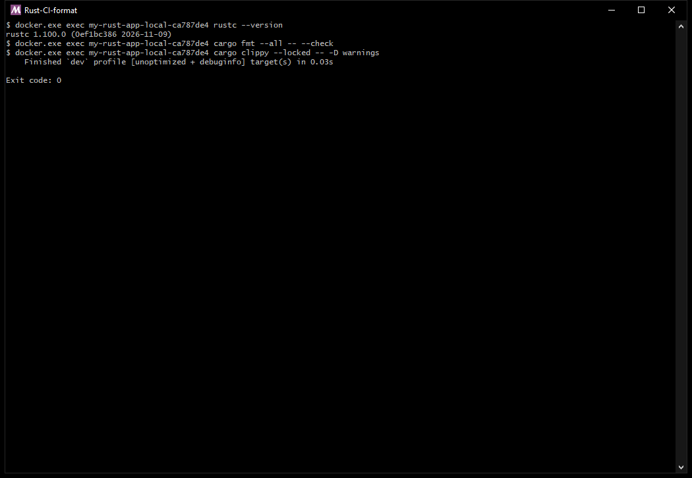

### Сборки Cargo

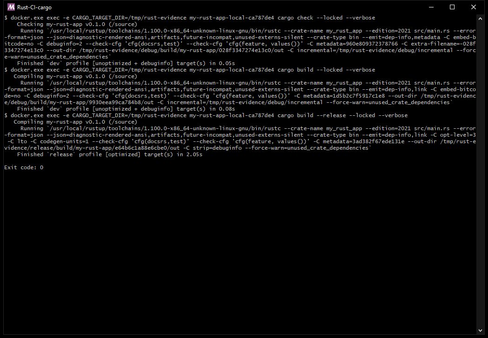

### Тесты Cargo

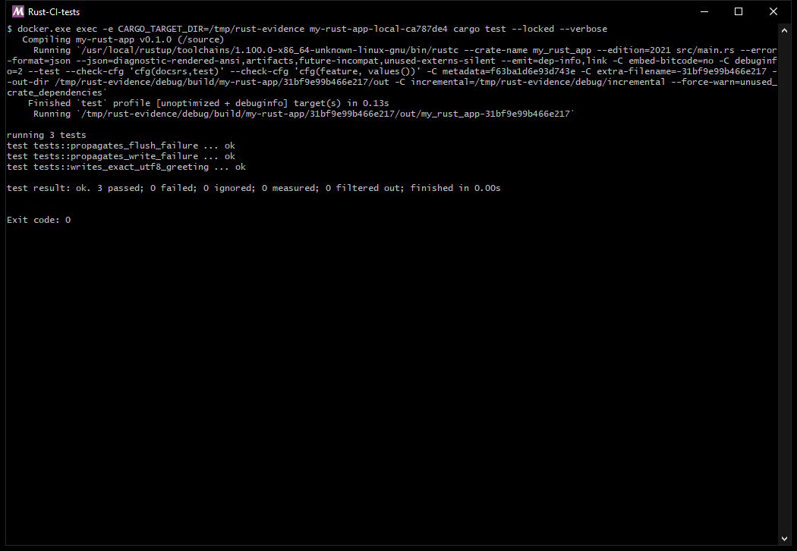

### Docker build

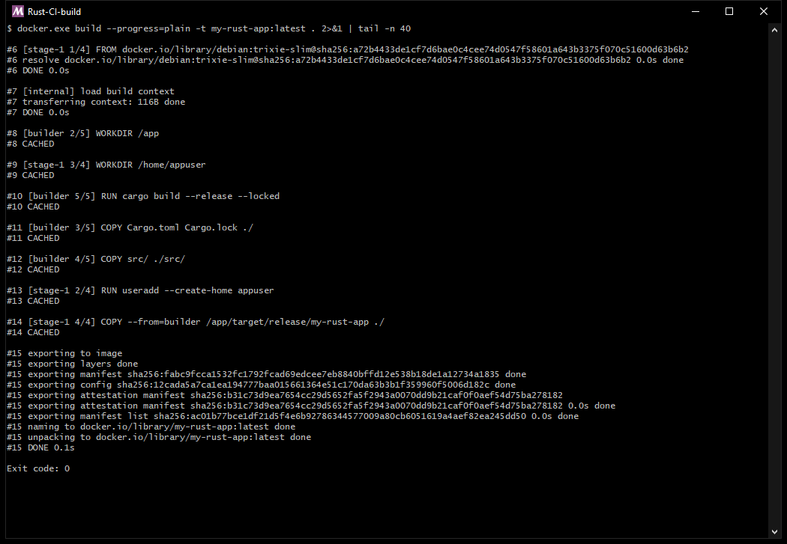

### Docker run

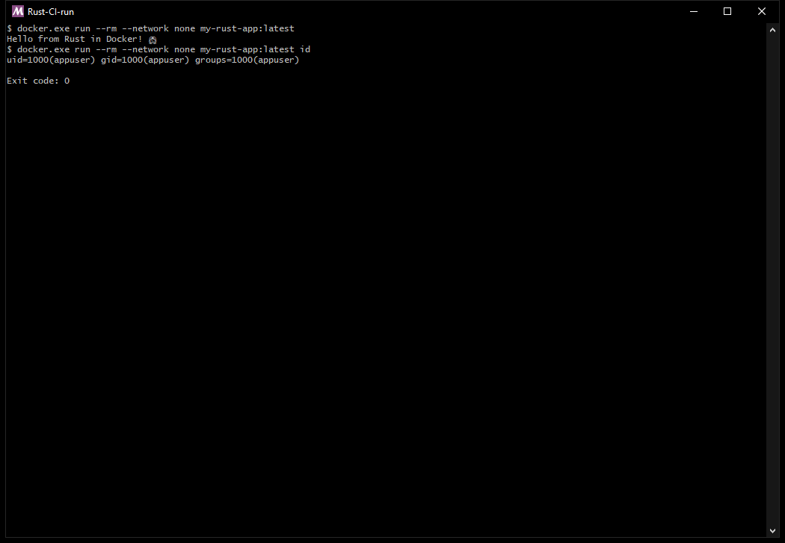

## Результаты GitHub Actions и Docker-артефакта

Первый запуск на коммите `6d2ce9b` завершился со статусом **Success**. GitHub выполнил задания последовательно. [GitHub Actions, запуск № 1](https://github.com/aleks-maker-maker/my-rust-app/actions/runs/44559837351)

| Задание | Статус | Результат |
| --- | --- | --- |
| [Lint & Format](https://github.com/aleks-maker-maker/my-rust-app/actions/runs/44559837351/job/135685769125) | Success | rustfmt и Clippy с `-D warnings` прошли. |
| [Build & Test](https://github.com/aleks-maker-maker/my-rust-app/actions/runs/44559837351/job/135685954423) | Success | `cargo check`, сборки debug и release и три модульных теста прошли. |
| [Build Docker Image](https://github.com/aleks-maker-maker/my-rust-app/actions/runs/44559837351/job/135686146728) | Success | Образ собран, архив загружен, проверены точный stdout, код выхода и UID. |

Артефакт **docker-image** содержит `docker-image.tar.gz`. Размер ZIP — **29 785 129 байт**. SHA-256 ZIP по данным GitHub — `172c5e3a8ef2951a1d4995c9c755e28219635992074ab8ef9061dc9af6a63337`. [Артефакт первого запуска](https://github.com/aleks-maker-maker/my-rust-app/actions/runs/44559837351/artifacts/14545794015)

Локально размер и SHA-256 скачанного ZIP совпали с данными GitHub. После `docker load` восстановленный образ `my-rust-app:latest` вывел строку `Hello from Rust in Docker! 🦀`, завершился с кодом `0` и запустился от `appuser` с UID `1000`.

### Как восстановить образ

Скачайте ZIP со страницы артефакта и сохраните его как `docker-image.zip` в отдельной временной папке. Следующие команды выполняются в этой папке в PowerShell.

~~~powershell
$expectedSha256 = '172c5e3a8ef2951a1d4995c9c755e28219635992074ab8ef9061dc9af6a63337'
$actualSha256 = (Get-FileHash -LiteralPath .\docker-image.zip -Algorithm SHA256).Hash
if ($actualSha256 -ine $expectedSha256) { throw 'SHA-256 mismatch' }
Expand-Archive -LiteralPath .\docker-image.zip -DestinationPath .\expanded
docker load -i .\expanded\docker-image.tar.gz
if ($LASTEXITCODE -ne 0) { throw 'docker load failed' }
docker run --rm --network none my-rust-app:latest
if ($LASTEXITCODE -ne 0) { throw 'Application failed' }
docker run --rm --network none my-rust-app:latest id
~~~

Для другого запуска возьмите значение `digest` его артефакта из GitHub REST API. GitHub хранит архив семь дней. Свежий архив можно скачать после нового запуска workflow.

### Сводка первого запуска

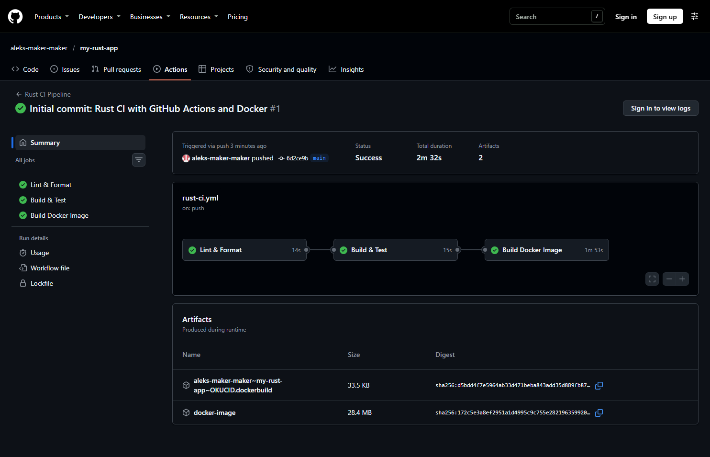

### Lint & Format

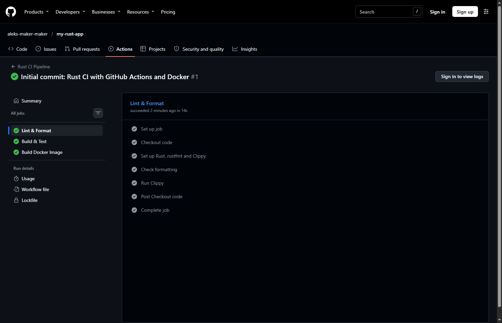

### Build & Test

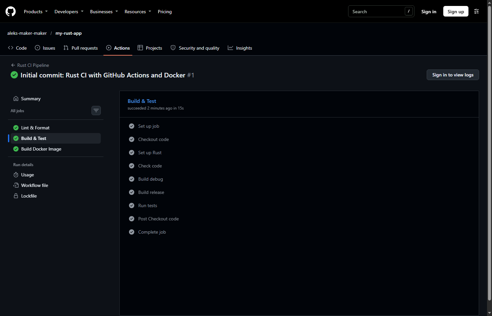

### Build Docker Image

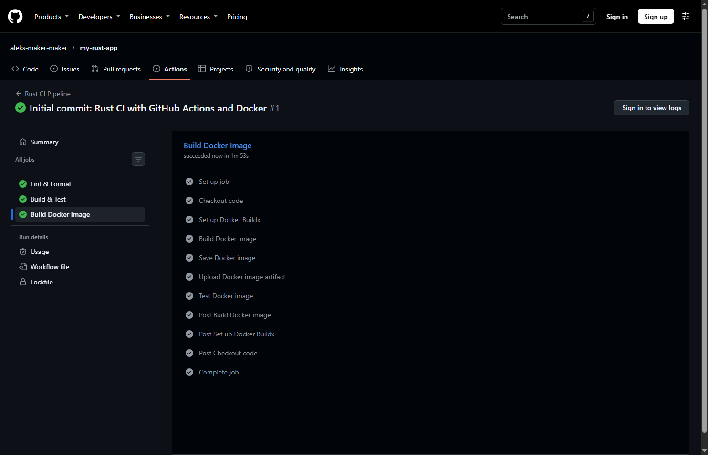

### Артефакт docker-image

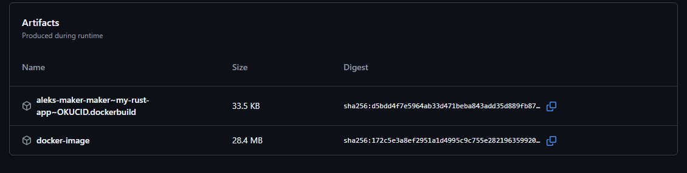

### Восстановление и запуск образа

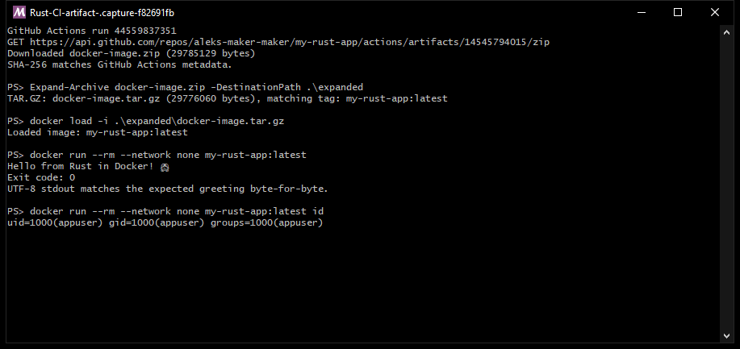
